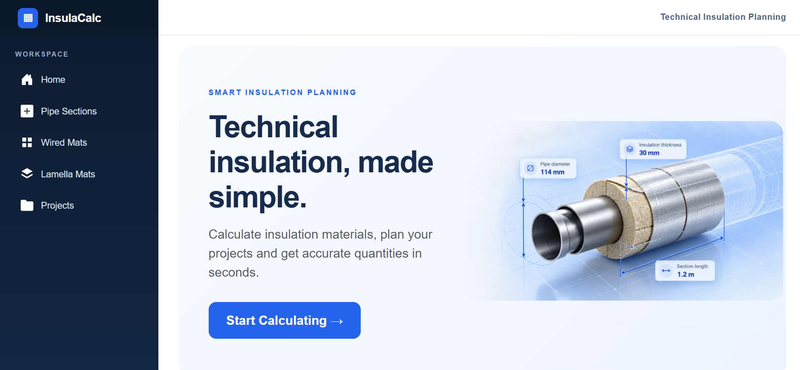
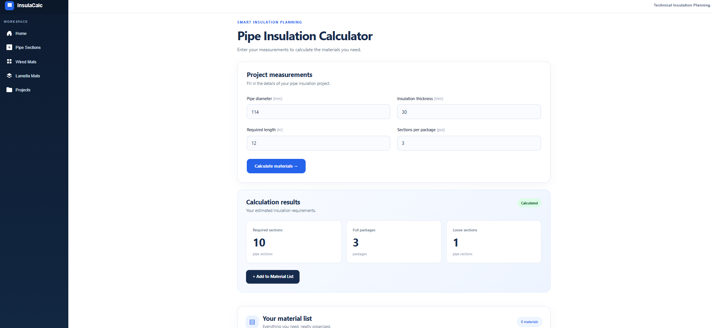
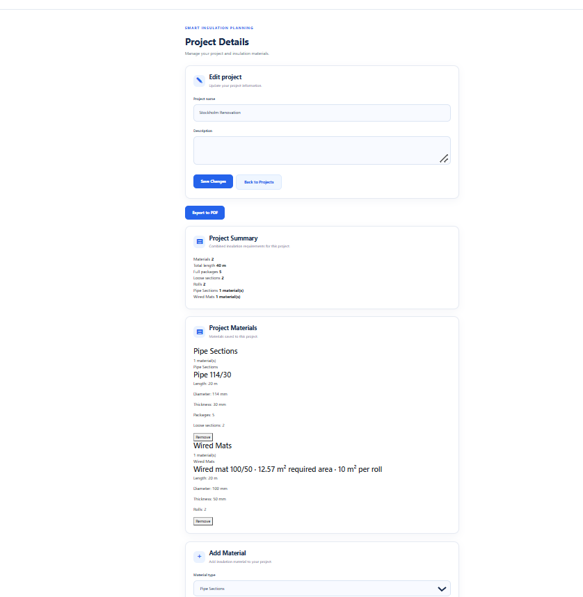

# InsulaCalc
**GitHub:** [fredrikjorman](https://github.com/fredrikjorman)

## Live Demo

Try InsulaCalc directly in your browser:

[Launch InsulaCalc](https://insulacalc-demo-gke7g7dzfnhuftas.swedencentral-01.azurewebsites.net)

Hosted on Microsoft Azure App Service.

**Note:** This is a portfolio demo. Project data is stored temporarily in memory and is not persisted between sessions.


**Technical insulation calculations, made simple.**

InsulaCalc is a web application built with C# and Blazor to help calculate insulation materials, organize material lists, and manage projects in one place.

The idea came from my previous experience working with technical insulation materials. I noticed how often material calculations and orders were handled manually, using pen, paper, or separate calculations. I wanted to explore how a simple digital tool could make that process easier.

This project is also part of my journey as a .NET development student, where I focus on building practical applications and improving my skills in software design and development.

---

## Screenshots

### Home



### Pipe Insulation Calculator



### Project Management



---

## Features

### Material calculators

Three calculators for common technical insulation products:

- **Pipe Sections** – Calculate required pipe sections, full packages, and loose sections based on pipe dimensions and required length.
- **Wired Mats** – Calculate material requirements for wired insulation mats.
- **Lamella Mats** – Calculate material requirements for lamella insulation mats.

### Project management

- Create, edit, and delete projects.
- Save calculated materials directly to a project.
- View and manage project material lists.
- See a summary of the materials included in a project.

### Export

- Export material lists to CSV.
- Generate PDF summaries of projects.

### Additional functionality

- Input validation for material calculations.
- Local JSON-based project storage.
- Responsive interface for desktop and mobile.
- Automated unit tests for calculation logic and project persistence.

---

## Tech stack

| Technology | Usage |
|---|---|
| C# / .NET | Application logic and backend |
| Blazor Server | Interactive web interface |
| HTML / CSS / Bootstrap | Layout and responsive design |
| xUnit | Automated unit testing |
| QuestPDF | PDF generation |
| JSON | Local project data storage |
| Git / GitHub | Version control |

---

## Getting started

### Prerequisites

- .NET SDK compatible with the project
- Visual Studio with ASP.NET and web development support, or another compatible .NET development environment

### Run locally

Clone the repository:

```bash
git clone https://github.com/fredrikjorman/InsulaCalc.git
```

Navigate to the application directory:

```bash
cd InsulaCalc/InsulaCalc
```

Run the application:

```bash
dotnet run
```

Open the local address displayed in your terminal.

### Run tests

From the repository root:

```bash
dotnet test
```

---

## Project structure

```text
InsulaCalc/
├── InsulaCalc/          # Blazor web application
│   ├── Components/      # Pages, layouts and UI
│   ├── Models/          # Data models
│   ├── Services/        # Calculation and project logic
│   └── wwwroot/         # Static assets and styling
│
├── InsulaCalc.Test/     # xUnit tests
└── InsulaCalc.slnx      # Visual Studio solution
```

---

## What I learned

Building InsulaCalc has given me practical experience in:

- Structuring a .NET application with separate models, services, and UI components.
- Implementing and testing calculation logic.
- Working with data persistence and project management.
- Generating downloadable CSV and PDF files.
- Building responsive interfaces with Blazor.
- Using Git branches to develop and integrate new features.

One of the most valuable parts has been turning an idea from a real working environment into a functioning application.

---

## Future improvements

Some areas I would like to explore further:

- Database storage instead of local JSON files.
- More insulation material types and calculation options.
- Improved project reporting and export functionality.
- Deployment to a hosted environment.

---

## About the developer

I'm a .NET development student at Nackademin in Stockholm, Sweden.

InsulaCalc is a personal portfolio project combining my previous experience in the technical insulation industry with my interest in software development.
